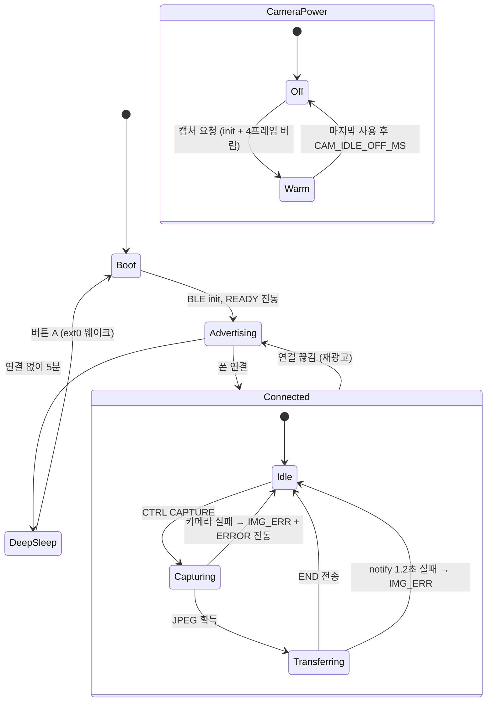
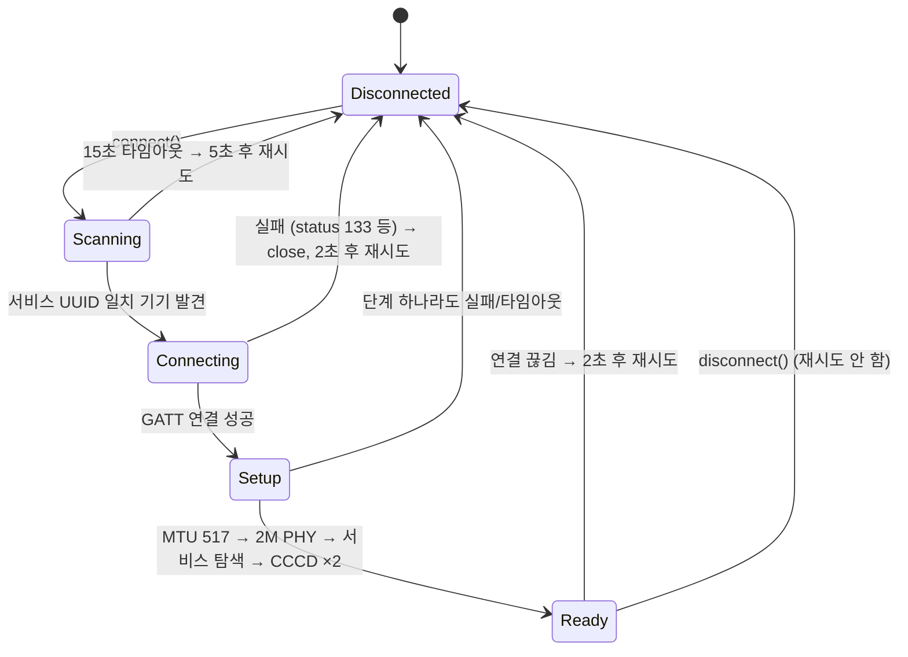
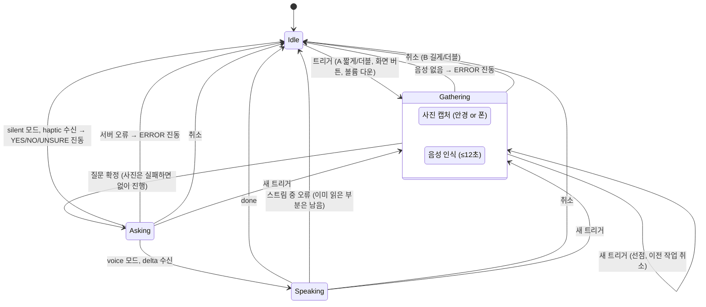

# secretum 설계 문서

> 대상 커밋: `ee12c14` (초기 스켈레톤) · 프로토콜 상세는 [PROTOCOL.md](PROTOCOL.md)
> 표기: **[실측]** 공개 측정치 · **[스펙]** 제조사 수치 · **[추정]** 근거 있는 가정, 실측으로 교체할 값

## 0. 요약

지금 스켈레톤은 기능 흐름은 다 연결돼 있지만, 실착용 기준으로 막히는 문제가 세 가지 있음.

| # | 문제 | 현재 | 목표 | 해결 방향 |
|---|---|---|---|---|
| 1 | **배터리** | 250mAh로 약 2시간 (전원 관리 없음) | 16시간 착용 기준 하루 이상 | BLE 라이트슬립, 연결 간격 동적 전환, 카메라 즉시 끄기 → §3 |
| 2 | **첫 음절 잘림** | 버튼 진동이 울린 뒤에도 0.3~0.6초 동안 폰 마이크가 안 켜져 있음 | 진동이 울리면 바로 녹음 중 | LISTENING 진동 추가, 폰 쪽 선녹음 버퍼 → §2.1 |
| 3 | **BLE 무방비** | 근처 아무 폰이나 연결해서 촬영 명령 가능 | 페어링된 폰 1대만 | LE Secure Connections 본딩 + 화이트리스트 → §6 |

---

## 1. 설계 원칙과 결정 기록

| ID | 결정 | 이유 | 버린 대안 |
|---|---|---|---|
| D1 | 안경에서는 AI 연산 안 함 | 전력·발열·무게. 연산은 폰/서버가 압도적으로 쌈 | 온디바이스 소형 모델 |
| D2 | 안경↔폰은 **BLE** | Wi-Fi 대비 대기 전력이 낮고 폰 핫스팟 의존이 없음 | Wi-Fi 직결 (Live 모드용으로만 보류) |
| D3 | 연속 영상이 아니라 **트리거 스틸컷** | BLE 대역폭(수십 KB/s)과 배터리 한계 | 상시 스트리밍 |
| D4 | 마이크는 **폰/이어폰** | BLE로 오디오를 실시간 전송하는 건 대역폭·지연·코덱 복잡도가 큼 | 안경 PDM 마이크 → BLE |
| D5 | STT는 **폰** (SpeechRecognizer) | 서버 왕복 1회 절약. 인터페이스를 분리해 둬서 Whisper로 교체 가능 | 서버 STT |
| D6 | 서버 히스토리는 **텍스트만** | 대화가 길어져도 이미지 토큰 비용이 누적되지 않음 | 이미지 포함 히스토리 |
| D7 | 무음 모드에서 형식이 깨지면 **UNSURE** | 잘못된 '예'가 '모름'보다 위험함 | 재질의 |
| D8 | 버튼 누름 진동은 **안경이 로컬에서** 냄 | 폰 왕복 없이 10ms 안에 피드백 | 폰이 명령 |
| D9 | VLM은 **프로바이더 추상화** | 클라우드 ↔ 자체 GPU(vLLM) 전환을 설정만으로 | 단일 벤더 고정 |
| D10 | 폰은 **Android 먼저** | 개발 반복 속도. 단, 구조가 BLE 기반이라 iOS 포팅도 막혀 있지 않음 (CoreBluetooth, Speech, AVSpeechSynthesizer) | – |

---

## 2. 지연 예산

체감 지연은 두 구간으로 나눠서 봐야 함.

- **말하기 전 구간**: 버튼을 누르고 녹음이 실제로 시작될 때까지. 길면 첫 음절이 잘림
- **말 끝난 후 구간**: 말이 끝나고 첫 음성 답이 나올 때까지. 이게 사용자가 느끼는 "응답 속도"

### 2.1 말하기 전 구간 (UX 결함)

| 단계 | 소요 | 근거 |
|---|---|---|
| 누름 → 제스처 확정 (SHORT) | **300ms** | `BTN_DOUBLE_GAP_MS`. 더블탭 여부를 기다려야 SHORT가 확정됨 |
| 안경 ACK 진동 | ~0ms | 확정 즉시 로컬에서 |
| BLE 알림 → 폰 수신 | ≤ 15ms | 연결 간격 7.5~15ms (다음 연결 이벤트까지) |
| SpeechRecognizer 생성 → `onReadyForSpeech` | 300~600ms **[추정]** | 기기·엔진마다 다름 |
| **ACK 진동부터 녹음 시작까지** | **약 0.3~0.6초 공백** | |

사용자는 진동을 "말해도 됨" 신호로 받아들임. 그런데 실제로는 그 뒤 0.3~0.6초 동안 마이크가 꺼져 있음. 누름부터 따지면 약 0.6~0.9초.

**조치 (우선순위 순)**
1. **P0** `HP_LISTENING` 패턴 추가 → `onReadyForSpeech`에서 발화. ACK는 "인식함", LISTENING은 "말해" 신호로 분리
2. **P1** 폰이 `AudioRecord` 선녹음 링버퍼(1~2초)를 활성 세션 동안 유지 → 트리거 시점 이전 오디오부터 STT에 넣음. 근본 해결이지만 SpeechRecognizer 대신 직접 STT 엔진이 필요함 (D5 교체)
3. **P1** A 버튼의 SHORT를 즉시 확정: 무음 모드를 **B 더블**로 옮기면 A는 더블 판별이 필요 없어서 300ms가 사라짐 → 결정 필요 (§8 Q1)
4. **P2** 누르는 순간(제스처 확정 전) 폰에 `PREPARE`를 보내서 STT 엔진·카메라를 선기동

### 2.2 말 끝난 후 구간 (응답 속도)

캡처와 사진 전송은 말하는 동안 병렬로 끝나기 때문에 이 구간엔 안 들어감 (`AssistantPipeline`의 `async` 캡처).

| 단계 | p50 | p95 | 근거 |
|---|---|---|---|
| 끝맺음 판정 + STT 최종 결과 | 0.6s | 1.5s | **[추정]** 침묵 감지 시간이 대부분 |
| 업로드 (질문 + JPEG 30KB, LTE/5G) | 0.15s | 0.4s | **[추정]** |
| VLM 첫 토큰 (이미지 포함) | 1.2s | 2.5s | **[추정]** 모델·리전 의존. 가장 큰 변수 |
| 첫 문장 완성 (토큰 스트리밍) | 0.3s | 0.8s | **[추정]** 시스템 프롬프트가 1~3문장 구어체로 강제 |
| TTS 첫 발화 | 0.15s | 0.3s | **[추정]** |
| **합계** | **약 2.4s** | **약 5.5s** | |

**목표 (SLO)**: 말이 끝나고 첫 음성까지 p50 ≤ 2.5s, p95 ≤ 4.0s.
p95가 넘치는 주원인은 VLM 첫 토큰과 STT 끝맺음. 단축 레버는 아래 순서:

1. 서버를 VLM 엔드포인트와 가까운 리전에 배치하고 HTTP keep-alive 유지 (OkHttp 커넥션 풀 기본값으로 OK)
2. STT 부분 결과(partial)가 안정되면 끝맺음 전에 미리 질의 → 끝맺음 확정 시 결과 확정, 틀리면 버림 (추측 실행)
3. 프롬프트: "첫 문장은 결론부터 짧게" → 첫 문장 완성 시간 단축
4. 자체 GPU(vLLM)는 네트워크 홉은 줄지만 모델 속도가 관건이라 실측 후 판단

### 2.3 사진 전송 (병렬 구간이지만 상한 관리 필요)

| JPEG | 46 KB/s **[실측]** | 90 KB/s **[스펙]** |
|---|---|---|
| 20KB | 0.43s | 0.22s |
| 30KB (VGA q12 예상) | 0.65s | 0.33s |
| 40KB | 0.87s | 0.44s |

- 46 KB/s: ESP32-S3 NimBLE 처리량 예제의 포럼 실측. 2M PHY로 바꿔도 이 숫자가 그대로였다는 보고가 있음
- 90 KB/s: Espressif FAQ의 ESP32 보드 간 최대치(700 kbps). 2M PHY 최대 170 KB/s
- 폰이 상대일 때는 연결 이벤트당 패킷 수를 폰이 정해서 기기마다 다름 → `tools/ble_probe.py capture`로 실측해야 함

XGA(작은 글자 읽기)는 크기가 2.5배 이상 → 1~2초. 말하는 시간(보통 1.5~3초) 안에 끝나면 체감 0.

### 2.4 측정 지점

| 지점 | 위치 | 이미 있음 |
|---|---|---|
| 트리거 → 질문 확정, 이미지 크기, 소스 | 앱 로그 `Q[...] +Nms` | ✓ |
| 첫 토큰 | 앱 로그 `first token +Nms` | ✓ |
| 답변 완료 | 앱 로그 `A: ... +Nms` | ✓ |
| 서버 TTFT / 총 시간 | 서버 로그 `ttft= total=` | ✓ |
| 사진 전송 시간·크기 | 펌웨어 시리얼 `[img] ... in Nms` | ✓ |
| BLE 처리량 | `ble_probe.py capture` KB/s | ✓ |
| **`onReadyForSpeech`, `onEndOfSpeech` 시각** | `SpeechInput` | ✗ → **추가 필요** (2.1, 2.2 검증용) |
| **첫 TTS 발화 시각** | `SpeechOutput` `UtteranceProgressListener.onStart` | ✗ → **추가 필요** |

---

## 3. 전력 예산

### 3.1 상태별 소비 전류 (XIAO ESP32-S3 Sense, 3.8V)

| 상태 | 전류 | 근거 |
|---|---|---|
| BLE 활성 (확장보드 포함) | 102 mA | **[스펙]** Seeed |
| 모뎀슬립 (카메라 연결) | 44.6 mA | **[스펙]** Seeed |
| 모뎀슬립 (주변장치 없음) | 25.5 mA | **[스펙]** Seeed |
| BLE 라이트슬립, 메인 XTAL (칩 단독) | 3.3 mA | **[스펙]** Espressif |
| BLE 라이트슬립, 32kHz XTAL (칩 단독) | 0.23 mA | **[스펙]** Espressif |
| 라이트슬립 (카메라 연결) | 5.5 mA | **[스펙]** Seeed |
| 딥슬립 (카메라 연결) | **3.0 mA** | **[스펙]** Seeed. 보드 단독은 14µA인데 카메라 보드가 3mA를 새고 있음 |
| 캡처 + 전송 순간 | ~130 mA | **[추정]** 피크 108mA(보드) + 카메라 |
| 진동 펄스 | 50~100 mA × 수십 ms | **[추정]** 평균에 거의 영향 없음 |

**현재 펌웨어 위치**: `esp_pm` 설정이 없고 CPU 240MHz 고정, 연결 간격도 7.5~15ms로 계속 고정 → "BLE 활성" 구간(수십~100mA)에 머묾. **[추정, 실측 필요]**

카메라 보드의 3mA 누설은 XIAO에 카메라 PWDN 핀이 연결돼 있지 않아서(`CAM_PIN_PWDN -1`) 소프트웨어로는 못 끔. 딥슬립에서 100mA가 측정됐다는 사례도 있음 → 커스텀 PCB에서 카메라 전원을 로드 스위치로 끊어야 해결됨 (§7).

### 3.2 배터리 수명 (250mAh, 가용 85% = 212mAh)

| 시나리오 | 평균 전류 | 수명 |
|---|---|---|
| A. 현재 펌웨어 (BLE 활성 상시, 상한 가정) | ~102 mA | **2.1시간** (모뎀슬립이 일부 걸리면 최대 ~5시간) |
| B. 모뎀슬립 수준 | 44.6 mA | 4.8시간 |
| C. **목표**: BLE 라이트슬립 + 긴 연결 간격 | ~7 mA **[추정]** (칩 3.3 + 카메라 보드 ~3 + 여유) | **30시간** |
| D. 대기 (딥슬립) | 3.0 mA | 71시간 ≈ 3일 |

**하루 사용 (16시간 착용, 상호작용 50회)**

| | 소비 | 250mAh | 500mAh |
|---|---|---|---|
| 현재 | 1,651 mAh/일 | 0.13일 | 0.26일 |
| 목표 (C + 카메라 5초 후 끄기) | 116 mAh/일 | **1.8일** | 3.7일 |

### 3.3 상호작용 1회 비용 → 카메라는 바로 꺼야 함

| 항목 | 소비 |
|---|---|
| 캡처 + 전송 (1.5s × 130mA) | 0.054 mAh |
| 카메라 대기 60초 (현재 `CAM_IDLE_OFF_MS`, +19mA) | **0.318 mAh** |
| 카메라 대기 5초 | 0.026 mAh |

지금 설정이면 카메라를 켜둔 채 기다리는 비용이 실제 촬영 비용의 6배임. 카메라를 다시 켜는 콜드 스타트(초기화 + 노출 안정화용 4프레임 버림)는 약 0.5~1초 **[추정]** 걸리지만, 말하는 동안 병렬로 진행되니까 체감 손해가 없음. → **`CAM_IDLE_OFF_MS`를 5초 이하로, 혹은 촬영 직후 끄기 (P0)**.

### 3.4 전력 개선 순서

| 우선 | 항목 | 예상 효과 | 위치 |
|---|---|---|---|
| P0 | 카메라 대기 60초 → 5초 이하 | 상호작용당 −0.29 mAh | `config.h` |
| P0 | 연결 간격 동적 전환: 평소 100~200ms + slave latency 4, 사진 전송할 때만 7.5~15ms | BLE 활성 → 라이트슬립 진입 가능 | 펌웨어 `updateConnParams`, 앱 `requestConnectionPriority(BALANCED ↔ HIGH)` |
| P0 | `esp_pm_configure` (최대 80~160MHz, 최소 40MHz, `light_sleep_enable`) + NimBLE 모뎀슬립 | 시나리오 A → C | 펌웨어 setup. Arduino 프리빌트 sdkconfig에서 BLE 슬립 옵션이 꺼져 있으면 **ESP-IDF로 전환하거나 Arduino as component** 필요 → 첫 실측에서 확인 |
| P1 | `delay(5)` 폴링 → GPIO 인터럽트 + FreeRTOS 대기 | 틱이 깨우는 횟수 감소 | `buttons.cpp`, `loop()` |
| P1 | 32kHz 크리스털 (커스텀 PCB) | 라이트슬립 3.3 → 0.23 mA (칩) | §7 |
| P2 | 카메라 전원 로드 스위치 (커스텀 PCB) | 딥슬립 3mA → 수십 µA | §7 |

---

## 4. 상태 머신

### 4.1 안경 펌웨어

규칙
- 버튼 제스처는 어느 상태에서든 확정되는 즉시 로컬 진동 (연결 안 됐으면 ERROR, 됐으면 ACK + BTN 알림)
- **현재 한계**: `Transferring` 동안 `loop()`가 막혀서 버튼 폴링이 멈춤 → 그 사이(약 0.3~1초)에 짧게 눌렀다 떼면 놓침 (§5 F9)
- 촬영 LED는 `Capturing` 진입부터 `Transferring` 종료까지 켜짐

### 4.2 폰 BLE 링크 (`GlassesLink`)

규칙
- GATT 작업은 `opMutex`로 한 번에 하나만, 콜백 올 때까지 대기 (5초 타임아웃, 서비스 탐색은 10초)
- 끊기면 대기 중인 GATT 작업은 즉시 실패 처리
- **현재 한계**: 사진 수신 대기(`images.first()`)는 끊겨도 깨어나지 않고 8초 타임아웃까지 기다림 (§5 F3)

### 4.3 상호작용 파이프라인 (`AssistantPipeline`)

규칙
- 새 트리거는 항상 이전 작업을 선점함 (HTTP 요청 즉시 끊김, TTS 정지)
- 사진 실패는 치명적이지 않음 → 질문만으로 진행 (사진 없이 답할 수 있는 질문도 많음)
- **현재 한계**: 선점 시 안경이 이전 사진을 아직 보내는 중이면, 새 요청이 그 **이전 사진**을 받을 수 있음 (§5 F4)

---

## 5. 실패 시나리오

| ID | 상황 | 감지 | 현재 동작 | 사용자 체감 | 갭 / 조치 | 우선 |
|---|---|---|---|---|---|---|
| F1 | 폰 미연결 상태에서 버튼 | 펌웨어 `ble::connected()` | 즉시 ERROR 진동 | 명확함 | – | ✓ |
| F2 | 사진 전송 중 연결 끊김 | 펌웨어 notify 실패 | 펌웨어: 1.2초 재시도 후 포기 | – | – | ✓ |
| F3 | 〃 (폰 쪽) | `cleanup()` | 사진 대기가 **8초 타임아웃까지** 블록 → 그 뒤 사진 없이 질의 | 답이 최대 8초 늦어짐 | `cleanup()`에서 `images`에 Error 방출 → 즉시 실패 | **P0** |
| F4 | 선점 직후 이전 프레임 도착 | 없음 | 새 요청이 이전 사진을 받음 | **엉뚱한 장면에 대한 답** | CAPTURE에 requestId(arg2) 추가 → 펌웨어가 frameId로 에코 → 폰이 일치할 때만 수락 | **P0** |
| F5 | CRC 불일치 / 청크 순서 오류 | `ImageAssembler` | 1회 재캡처 | +0.5~1초 | – | ✓ |
| F6 | 카메라 초기화 실패 (PSRAM 꺼짐 등) | `esp_camera_init` | IMG_ERR(1) + ERROR 진동 → 폰 재시도도 실패 → 사진 없이 질의 | 진동 후 답은 옴 | 부팅 시 PSRAM 경고 로그는 있음. BTN/STATUS로 폰에 상태 보고 추가 | P2 |
| F7 | 음성 인식 실패/무음 | `onError` / 12초 타임아웃 | ERROR 진동 | 명확함 | 에러 종류별 구분 (권한 없음 vs 무음) | P2 |
| F8 | 첫 음절 잘림 | 없음 | 감지 안 됨 | 질문이 틀어짐 | §2.1 | **P0** |
| F9 | 전송 중 버튼 누름 | 없음 | 폴링이 멈춰서 짧은 누름은 놓침 | 버튼이 씹힘 | 전송을 별도 FreeRTOS 태스크로 분리, 버튼은 GPIO 인터럽트 | P1 |
| F10 | CTRL 큐(8개) 가득 | 없음 | 명령 조용히 버림 | 캡처 타임아웃 | 정상 사용에선 거의 불가능. 통계 카운터만 | P3 |
| F11 | 서버 접속 불가 | OkHttp `onFailure` | Failed → ERROR 진동 | 명확함 | 오프라인 대체 (온디바이스 소형 VLM) | P3 |
| F12 | 모델 스트림 중간 오류 | SSE error | 이미 읽은 문장은 읽히고 ERROR 진동 | 말하다 끊김 | 수용 가능 | ✓ |
| F13 | 무음 모드에서 모델이 형식 위반 | `parse_verdict` | UNSURE | 안전 쪽 | – | ✓ |
| F14 | 앱이 백그라운드/화면 꺼짐 | 없음 | 파이프라인 정지 (Activity 수명) | **안경이 먹통** | 포그라운드 서비스 (`connectedDevice\|microphone\|camera`) | **P0** (실사용) |
| F15 | GATT 133 / 연결 실패 반복 | 콜백 status | close 후 2초 간격 무한 재시도 | 배터리 소모 | 지수 백오프 (2→4→8…최대 60초) | P2 |
| F16 | 서버 재시작 | – | 세션 히스토리 소실 (인메모리) | "아까 그거"가 안 통함 | Redis | P2 |
| F17 | 소수점 "3.5"에서 TTS가 문장 끊음 | – | 어색하게 끊김 | 경미 | '.' 뒤 공백/끝 확인 | P3 |
| F18 | 안경 장착 방향 때문에 사진이 뒤집힘 | – | VLM이 대개 알아서 처리 | 글자 읽기 정확도 하락 | 펌웨어 `set_vflip` / `set_hmirror` 설정값화 | P2 |

---

## 6. 보안 · 프라이버시

| 위협 | 현재 | 조치 | 우선 |
|---|---|---|---|
| 근처 타인 폰이 BLE로 연결해 **촬영 명령** → 사진 탈취 | 무방비 (서비스 UUID만 맞으면 연결) | LE Secure Connections 본딩 + 본딩된 기기만 허용(화이트리스트) + CTRL/IMG 특성에 암호화 필수 권한 | **P0** (밖에서 착용하기 전) |
| APK에서 `APP_TOKEN` 추출 | BuildConfig 고정 토큰 | 기기별 토큰 발급 + 회전, 서버 레이트리밋 | P0 (배포 전) |
| 전송 중 도청 | 개발용 cleartext 허용 | 운영은 HTTPS만 (`usesCleartextTraffic=false`) | P0 (배포 전) |
| 몰래 촬영 의심 | 촬영 LED가 **소프트웨어로** 켜짐 | 커스텀 PCB에서 LED를 카메라 전원 레일에 하드와이어링 → 펌웨어로 못 끔 | P1 |
| 사진 보관 | 서버에 저장 안 함 (`memory.py` 비어 있음), 로그에도 안 남김 | 라이프로그 도입 시 원본 미보관 기본, 캡션만. 보관하면 암호화 + 보존기간 | 설계 원칙 |
| 제3자 모델 사업자에게 사진 전송 | 클라우드 프로바이더 사용 시 | 민감한 용도는 자체 GPU(`openai_compat`)로 | 운영 정책 |

---

## 7. 폼팩터 · 하드웨어 로드맵

단계마다 **통과 기준(게이트)**을 두고, 통과하지 못하면 다음 단계 비용을 쓰지 않음.

### Phase 0 — 개발보드 클립온 (지금)
- XIAO Sense + DRV2605L 브레이크아웃 + 버튼, 3D 프린트 마운트
- **게이트**: 본인이 2주간 매일 씀 · 말 끝나고 첫 음성까지 p50 ≤ 3초 · 혼합 사용 배터리 ≥ 8시간 (§3.4 P0 반영 후)

### Phase 1 — 착용형 프로토 (기성 부품 유지)
- 좌우 분리: **오른쪽 다리** = MCU + 카메라 + 버튼, **왼쪽 다리** = 배터리 + 진동 모터 → 무게 균형
- 좌우를 잇는 배선은 앞쪽 프레임을 지나감. 힌지 통과가 가장 큰 기구 난제 (얇은 FPC 또는 힌지 옆 우회)
- 카메라는 앞쪽 프레임 끝(엔드피스)에, 시선과 평행하게
- 장시간 피부에 닿는 면은 표면 온도 제한이 있음 (IEC 62368-1 접촉 온도 기준) → MCU·배터리를 피부 반대쪽으로, 실측 필수
- **게이트**: 4시간 연속 착용 시 불편함·발열 없음 · 케이블/힌지 1,000회 개폐 내구

### Phase 2 — 커스텀 PCB
| 블록 | 후보 | 이유 |
|---|---|---|
| SoC | **ESP32-S3-PICO-1-N8R2** (LGA 7×7mm, 8MB 플래시·2MB PSRAM·40MHz 크리스털 내장 SiP) | 펌웨어 그대로 이식. 2MB PSRAM이면 XGA JPEG 프레임버퍼 2장에 충분. N8R8은 동작 온도 상한이 65°C라 N8R2(85°C)가 착용 기기에 유리 |
| 안테나 | 칩 안테나 + 키프아웃 | SiP에 안테나 없음. **머리 쪽 반대 방향**으로 배치 (인체가 2.4GHz 흡수) |
| 32kHz 크리스털 | 추가 | BLE 라이트슬립 3.3 → 0.23 mA (§3.1) |
| 카메라 | OV3660급 FPC 모듈 + **전원 로드 스위치** + PWDN 배선 | Seeed도 OV2640 단종 후 OV3660으로 바꿨음. 로드 스위치로 딥슬립 누설 3mA 제거 |
| 햅틱 | DRV2605L ×2 (I2C 버스 2개) | 주소가 0x5A 고정 → 좌우 모터에 방향 안내 (LEFT/RIGHT 패턴) |
| 전원 | LiPo 충전 IC + 퓨얼게이지 + 저Iq 벅 | 배터리 잔량을 폰에 보고 (지금은 측정 불가) |
| 촬영 LED | 카메라 전원 레일에 하드와이어링 | §6 |
| **게이트** | 시제품 5대 · 대기 ≥ 2주 · 혼합 사용 ≥ 16시간 | |

### Phase 3 — 판매를 한다면
- 전파 인증 (국내 KC 적합성평가, 해외 판매 시 FCC/CE), 리튬 배터리 안전 인증 → 비용·기간은 시험소 견적 필요
- 촬영 기기라 개인정보 관련 법적 검토 (법률 자문 필요)
- 이 단계 진입 여부는 Phase 2 결과와 차별화 포인트(무음 모드, 자체 호스팅 프라이버시 등)로 판단

---

## 8. 백로그

### P0 — 실사용 전 필수
| # | 내용 | 위치 |
|---|---|---|
| 1 | `CAM_IDLE_OFF_MS` 60s → 5s 이하 | `firmware/.../config.h` |
| 2 | 연결 간격 동적 전환 (평소 저속, 전송 시 고속) | `ble_link.cpp`, `GlassesLink.kt` |
| 3 | `esp_pm` 라이트슬립 + BLE 모뎀슬립 (Arduino 프리빌트로 안 되면 IDF 전환 결정) | 펌웨어 setup |
| 4 | `HP_LISTENING` 패턴 + `onReadyForSpeech`에서 발화 | `protocol.h`, `haptics.cpp`, `SpeechInput.kt`, `AssistantPipeline.kt` |
| 5 | 끊김 시 사진 대기 즉시 실패 (F3) | `GlassesLink.cleanup()` |
| 6 | CAPTURE requestId ↔ frameId 매칭 (F4) | `protocol.h`, `secretum_glasses.ino`, `GlassesLink.kt` |
| 7 | BLE 본딩 + 화이트리스트 + 암호화 필수 특성 | `ble_link.cpp`, `GlassesLink.kt` |
| 8 | 포그라운드 서비스로 파이프라인 이전 (F14) | 앱 |
| 9 | 측정 지점 추가: `onReadyForSpeech`, `onEndOfSpeech`, TTS `onStart` | `SpeechInput.kt`, `SpeechOutput.kt` |

### P1
| # | 내용 |
|---|---|
| 10 | 사진 전송을 별도 태스크로, 버튼은 인터럽트로 (F9) |
| 11 | 선녹음 링버퍼 + STT 엔진 교체 (§2.1-2) |
| 12 | BT 이어폰 마이크 라우팅 + 이어폰 버튼(MediaSession) 트리거 |
| 13 | STT partial 기반 추측 질의 (§2.2-2) |

### P2 이하
F6, F7, F15, F16, F17, F18, 라이프로그(`memory.py`), 배터리 잔량 보고, 좌우 모터

### 결정 필요
| Q | 질문 | 선택지 |
|---|---|---|
| Q1 | A 짧게 300ms 지연을 없앨 것인가 | (a) 무음 모드를 B 더블로 이동 → A 즉시 반응 (b) 현행 유지 |
| Q2 | 펌웨어 프레임워크 | (a) Arduino 유지 (BLE 슬립 옵션이 되면) (b) ESP-IDF 전환 (전원 관리 완전 제어) |
| Q3 | 기본 VLM | (a) 클라우드 (b) 자체 GPU vLLM — 지연·비용 실측 후 |

---

## 9. 근거

- ESP32-S3 NimBLE 처리량 실측 46 KB/s, 2M PHY로 개선 없음 — https://esp32.com/viewtopic.php?p=134134
- ESP32 BLE 최대 처리량 700 kbps / 2M PHY 1.4 Mbps — https://docs.espressif.com/projects/esp-faq/en/latest/software-framework/bt/ble.html
- ESP32-S3 BLE 소비전류 (모뎀슬립 17.9mA, 라이트슬립 3.3mA / 230µA) — https://docs.espressif.com/projects/esp-techpedia/en/latest/esp-friends/advanced-development/ble-application-note/performance.html
- XIAO ESP32-S3 Sense 상태별 소비전류, OV2640 → OV3660 변경 — https://wiki.seeedstudio.com/xiao_esp32s3_getting_started , https://www.thepihut.com/products/seeed-studio-xiao-esp32s3-sense
- XIAO Sense 카메라 연결 시 딥슬립 전류 문제 — https://forum.arduino.cc/t/high-power-consumption-during-deep-sleep-on-seeed-studio-xiao-esp32s3/1325985
- XIAO 라이트슬립 실측이 스펙보다 낮음 (S3 692µA) — https://www.qoitech.com/?p=19961
- ESP32-S3-PICO-1 (LGA 7×7, N8R2/N8R8) — https://www.espressif.com/sites/default/files/documentation/esp32-s3-pico-1_datasheet_en.pdf
